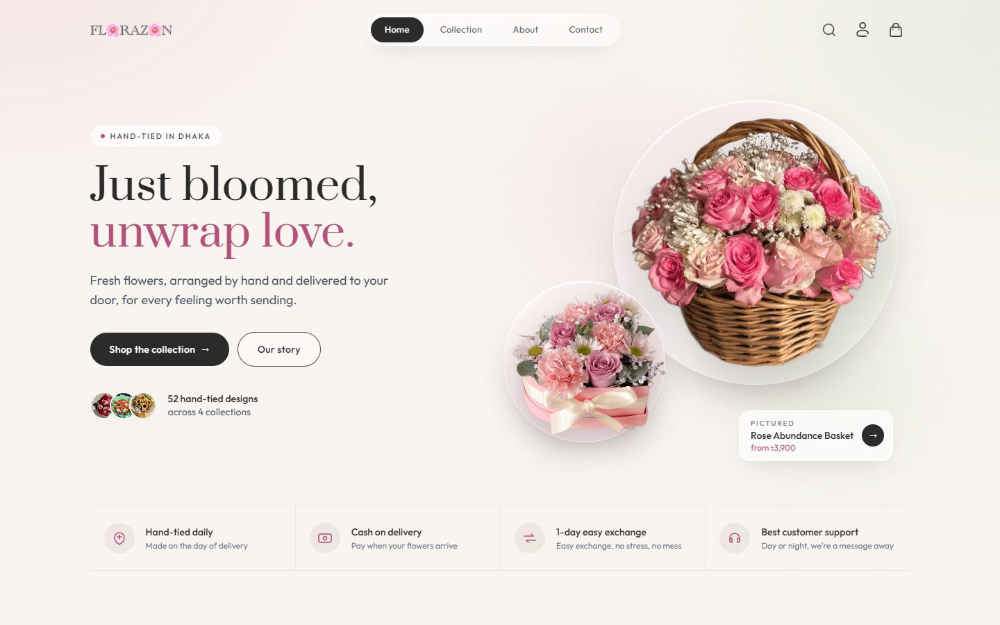
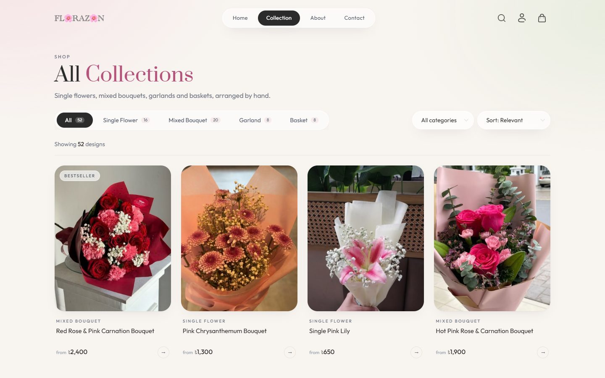
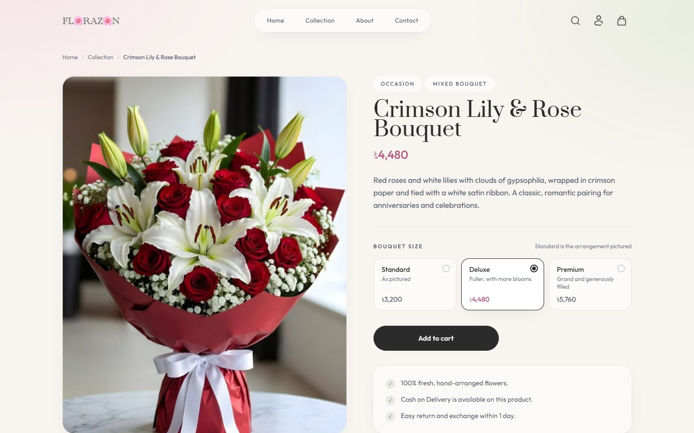
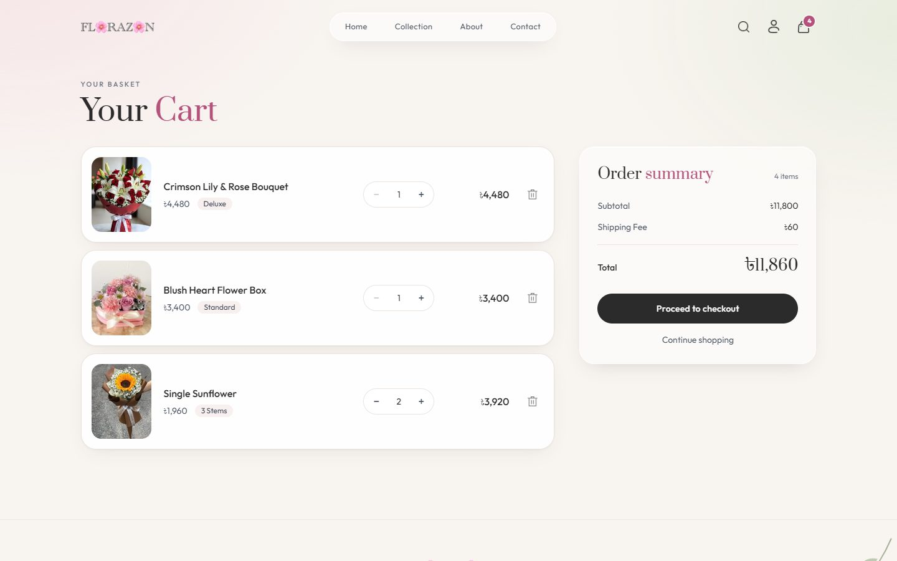
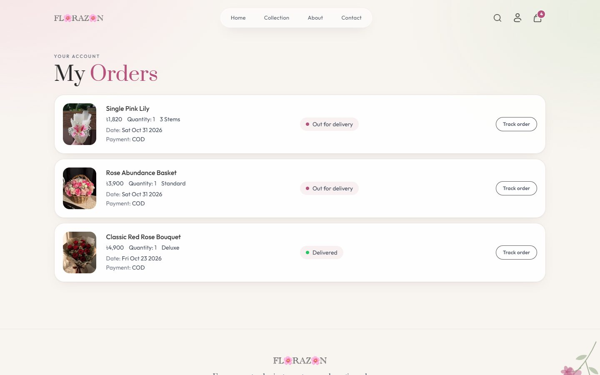
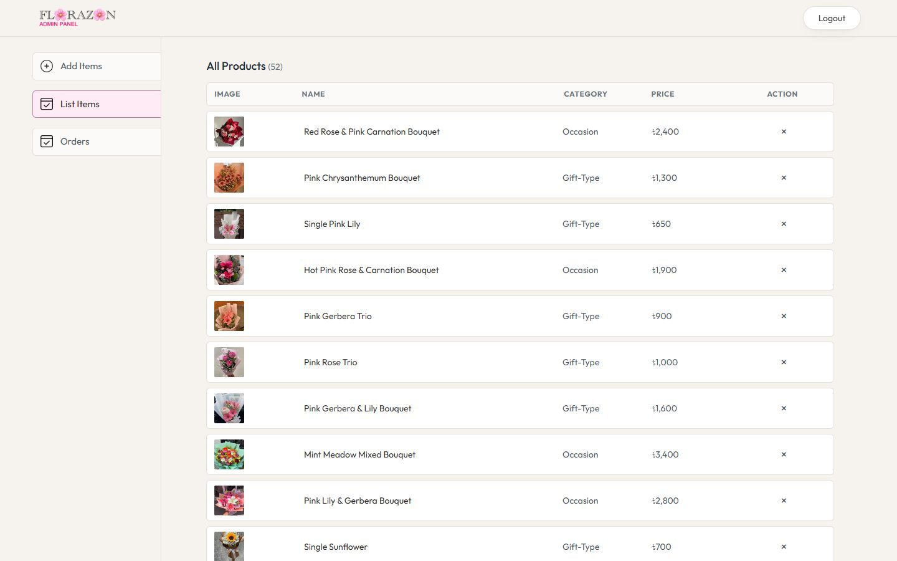
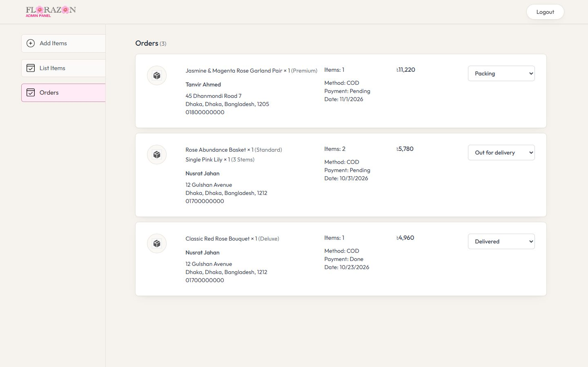
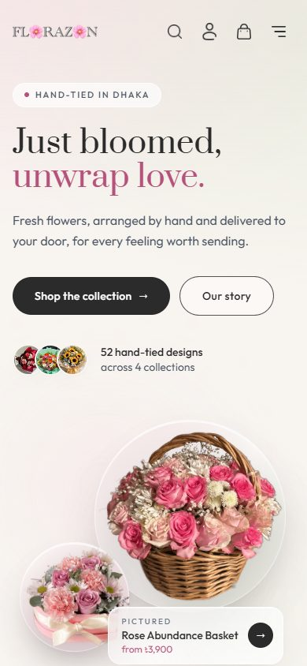
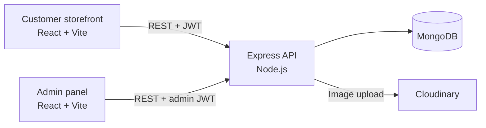

# Florazon

Florazon is a full-stack e-commerce platform for a flower shop, built with the MERN stack (MongoDB, Express, React, Node.js). Customers browse hand-tied bouquets, single flowers, wedding garlands and flower baskets, choose a bouquet size or number of stems, and order with Cash on Delivery. Store staff manage products and deliveries from a separate admin panel.


[](LICENSE)



## Live Demo

| Application | URL |
| --- | --- |
| Storefront | [florazon.vercel.app](https://florazon.vercel.app) |
| Admin panel | [florazon-admin.vercel.app](https://florazon-admin.vercel.app) |
| REST API | [florazon.onrender.com](https://florazon.onrender.com) |

The API runs on Render's free plan and sleeps when idle, so the first visit after a quiet period can take up to a minute to load the products.

## Overview

The repository contains three independent applications that share one REST API:

| Application | Description | Default URL |
| --- | --- | --- |
| `frontend/` | Customer storefront | http://localhost:5173 |
| `admin/` | Store administration panel | http://localhost:5175 |
| `backend/` | REST API used by both clients | http://localhost:4000 |

The catalogue holds 52 products across four collections:

| Collection | What it contains |
| --- | --- |
| Single Flower | Single stems and bouquets of one flower variety, such as all roses or all tulips |
| Mixed Bouquet | Hand-tied arrangements that combine several kinds of flowers |
| Garland | Fresh flower garlands sold in matching pairs for weddings and ceremonies |
| Basket | Arrangements in a keepsake basket, crate or gift box |

## Features

### Customer Storefront

- **Shop by collection:** the home page introduces the four collections, the newest arrivals and the best sellers.
- **Collection browsing:** type tabs with live counts, a category filter (Occasion, Gift Type), price sorting and name search, all in one toolbar.
- **Flower options:** every product offers either a bouquet size or a number of stems, with the price for each option shown before it is added to the cart (see [Flower options and pricing](#flower-options-and-pricing)).
- **Product pages:** an image gallery with hover zoom, option cards, a description and related products.
- **Persistent cart:** quantity steppers, a running order summary, and a cart that is saved to the account. Items added before signing in are merged into the account at sign-in.
- **Checkout and orders:** a delivery form with Cash on Delivery, and an order history that shows each order's status, from Order Placed through Packing, Shipped and Out for delivery to Delivered.
- **Accounts:** registration, sign-in with JWT sessions that expire automatically, and a profile page for updating details and changing the password.
- **Contact page:** store details, a message form that opens the visitor's email app with the message ready to send, and a map with directions.
- **Responsive design:** layouts tested from 360px phones to 2560px monitors, with subtle scroll and page transitions that respect the reduced-motion setting.

### Admin Panel

- **Secure login:** admin credentials are kept in server environment variables, and admin tokens expire after a set time.
- **Product creation:** up to four images uploaded to Cloudinary, plus name, description, category, collection, base price, a best-seller flag, and whether the product is sold as a bouquet (in sizes) or as single stems.
- **Catalogue management:** a list of every product, with removal behind a confirmation step.
- **Order management:** every order with its items, chosen options, customer and address, and a status control for each stage of delivery.

## Screenshots

| Collection | Product with options |
| --- | --- |
|  |  |

| Shopping cart | Order history |
| --- | --- |
|  |  |

| Admin: products | Admin: orders |
| --- | --- |
|  |  |

| Admin: add product | Mobile |
| --- | --- |
|  |  |

## Flower Options and Pricing

Each product is sold in one of two ways, and every option is priced from the product's base price:

| Sold as | Options | Price |
| --- | --- | --- |
| Bouquet (bouquets, garlands and baskets) | Standard (as pictured), Deluxe, Premium | 1×, 1.4×, 1.8× the base price |
| Single stems | 1 Stem, 3 Stems, 6 Stems | 1×, 2.8×, 5.4× the base price |

Prices are rounded to the nearest ৳10. For example, a ৳3,200 bouquet costs ৳4,480 as Deluxe and ৳5,760 as Premium. The rules live in `backend/config/productOptions.js`, and the storefront uses an identical copy in `frontend/src/utils/productOptions.js` to show prices. The server always recalculates the order total.

## Technology Stack

| Layer | Technologies |
| --- | --- |
| Frontend and admin | React 19, React Router 7, Vite 7, Tailwind CSS 3, Axios, React Toastify |
| Backend | Node.js, Express 5, Mongoose 8 |
| Database | MongoDB (Atlas or self-hosted) |
| Authentication and security | JSON Web Tokens, bcrypt, validator, express-rate-limit |
| File uploads | Multer, Cloudinary |
| Tooling | ESLint 9, Nodemon, PostCSS, Autoprefixer |

## Architecture



- **Stateless authentication:** the API issues JWTs. Customer tokens are valid for 7 days and admin tokens for 1 day.
- **Server-side pricing:** order totals are rebuilt from database prices and each item's chosen option, never taken from the client.
- **Persistent carts:** carts are stored on the user record, so they survive page reloads and follow the customer across devices.

## Getting Started

### Prerequisites

- [Node.js](https://nodejs.org/) 20 or later, with npm
- A [MongoDB](https://www.mongodb.com/atlas) database (MongoDB Atlas or a local instance)
- A [Cloudinary](https://cloudinary.com/) account for product image storage

### 1. Clone the repository

```bash
git clone https://github.com/AzmariSultana/Florazon.git
cd Florazon
```

### 2. Install dependencies

```bash
cd backend && npm install && cd ..
cd frontend && npm install && cd ..
cd admin && npm install && cd ..
```

### 3. Configure environment variables

Each application includes a `.env.example` file. Copy it to `.env` in the same folder and fill in your values.

**backend/.env**

| Variable | Description |
| --- | --- |
| `PORT` | Port for the API (default `4000`) |
| `MONGODB_URI` | MongoDB connection string. The `florazon` database is selected automatically. |
| `JWT_SECRET` | Long random string used to sign tokens |
| `ADMIN_EMAIL` | Email address for the admin panel login |
| `ADMIN_PASSWORD` | Password for the admin panel login |
| `CLOUDINARY_NAME` | Cloudinary cloud name |
| `CLOUDINARY_API_KEY` | Cloudinary API key |
| `CLOUDINARY_SECRET_KEY` | Cloudinary API secret |
| `CORS_ORIGINS` | Optional. Comma-separated list of allowed site origins in production |

**frontend/.env** and **admin/.env**

| Variable | Description |
| --- | --- |
| `VITE_BACKEND_URL` | Base URL of the API, for example `http://localhost:4000` |

`.env` files are excluded from version control. Never commit real credentials.

### 4. Start the applications

Run each application in its own terminal.

```bash
cd backend
npm run server
```

```bash
cd frontend
npm run dev
```

```bash
cd admin
npm run dev
```

### 5. Load the product catalogue

With `backend/.env` configured, import the catalogue from `backend/seed/products.json`. Each photo in `backend/seed/images/` is uploaded to Cloudinary.

```bash
cd backend
npm run seed
```

The script only adds products that are not in the database yet and never deletes anything. To apply changes to existing products, such as a new price or description, run `npm run seed -- --update`. Each run ends with a report of duplicates, products missing from the catalogue, and products without an image.

### Available Scripts

| Location | Command | Description |
| --- | --- | --- |
| `backend` | `npm start` | Start the API with Node.js |
| `backend` | `npm run server` | Start the API with Nodemon (reloads on changes) |
| `backend` | `npm run seed` | Import the product catalogue into MongoDB and Cloudinary |
| `frontend`, `admin` | `npm run dev` | Start the Vite development server |
| `frontend`, `admin` | `npm run build` | Create a production build in `dist/` |
| `frontend`, `admin` | `npm run preview` | Serve the production build locally |
| `frontend`, `admin` | `npm run lint` | Run ESLint |

## Usage

1. **Add products:** run `npm run seed`, or sign in to the admin panel at http://localhost:5175 with `ADMIN_EMAIL` and `ADMIN_PASSWORD` and use **Add Items**.
2. **Shop:** open the storefront at http://localhost:5173, pick a collection, choose a bouquet size or number of stems, and add items to the cart.
3. **Check out:** create an account or sign in, enter delivery details and place a Cash on Delivery order.
4. **Fulfil orders:** in the admin panel, open **Orders** and update each order's status. The customer sees the change under **My Orders**.

## Deployment

The API is deployed to [Render](https://render.com) and the two React applications to [Vercel](https://vercel.com). Deploy the API first, because both frontends need its URL.

### 1. API on Render

The repository includes a Render Blueprint (`render.yaml`) that configures the service.

1. In MongoDB Atlas, open **Network Access** and allow connections from `0.0.0.0/0`. Render's free plan does not use fixed IP addresses.
2. In Render, choose **New > Blueprint** and select this repository.
3. Enter the requested environment variables: `MONGODB_URI`, `ADMIN_EMAIL`, `ADMIN_PASSWORD`, `CLOUDINARY_NAME`, `CLOUDINARY_API_KEY` and `CLOUDINARY_SECRET_KEY`. `JWT_SECRET` is generated automatically. Leave `CORS_ORIGINS` empty for now.
4. Deploy. When the service is live, its URL (for example `https://florazon.onrender.com`) shows `API Working`.

### 2. Storefront and admin panel on Vercel

Create two Vercel projects from this repository, one for each application. Each folder contains a `vercel.json` with the build settings and the routing rule that keeps page links working on refresh.

| Setting | Storefront project | Admin project |
| --- | --- | --- |
| Root Directory | `frontend` | `admin` |
| Framework Preset | Vite (detected) | Vite (detected) |
| Environment variable | `VITE_BACKEND_URL` = Render API URL | `VITE_BACKEND_URL` = Render API URL |

Enter the API URL without a trailing slash. Vite reads environment variables at build time, so redeploy a project after changing its `VITE_BACKEND_URL`.

### 3. Connect the API to the frontends

Return to the Render service and set `CORS_ORIGINS` to both Vercel URLs, separated by a comma:

```
https://florazon.vercel.app,https://florazon-admin.vercel.app
```

Saving the change redeploys the API. From then on, it only accepts browser requests from these two sites.

### Alternative: GitHub Pages

`.github/workflows/deploy-pages.yml` can also publish both applications to GitHub Pages, at https://azmarisultana.github.io/Florazon/ and https://azmarisultana.github.io/Florazon/admin/. It runs on pushes to `main` that change `frontend/` or `admin/` and reads the API URL from the repository variable `VITE_BACKEND_URL` (**Settings > Secrets and variables > Actions > Variables**). If you use it, add the Pages URL to `CORS_ORIGINS` as well.

## Security

- **Passwords** are hashed with bcrypt, and changing a password requires the current one.
- **JWT sessions** expire. Admin tokens carry a role claim and never contain credentials.
- **Rate limiting** protects the sign-in, registration and password endpoints.
- **Order totals** are calculated on the server from database prices and each item's option, and quantities are validated.
- **Product options** submitted from the admin panel are checked against the allowed sets.
- **MongoDB query filters** are sanitised to prevent operator injection, and cart input is validated to prevent prototype pollution.
- **Uploads** are limited to image files under 5 MB, and temporary files are deleted after upload.

## Project Structure

```
Florazon/
├── backend/                 Express REST API
│   ├── config/              Database, Cloudinary, constants and flower option pricing
│   ├── controllers/         Request handlers (user, product, cart, order)
│   ├── middleware/          Authentication, rate limiting and file uploads
│   ├── models/              Mongoose schemas
│   ├── routes/              Route definitions
│   ├── seed/                Product catalogue, product photos and import script
│   └── server.js            Application entry point
├── frontend/                Customer storefront (React + Vite)
│   └── src/
│       ├── assets/          Logo, icons and cut-out imagery
│       ├── components/      Shared UI: navigation, product cards, hero, footer
│       ├── context/         Global state: products, cart and authentication
│       ├── pages/           Home, collection, product, cart, checkout and account pages
│       └── utils/           Formatting and flower option pricing
├── admin/                   Admin panel (React + Vite)
│   └── src/
│       ├── components/      Login, navigation bar and sidebar
│       └── pages/           Add, list and order management pages
└── docs/screenshots/        Images used in this README
```

## Roadmap

- Online payments (for example SSLCommerz or Stripe) alongside Cash on Delivery
- Editing existing products from the admin panel
- Sending contact form messages directly from the site
- Password reset by email
- Sales dashboard with order and revenue statistics
- Product reviews and ratings
- Automated tests and continuous integration

## License

This project is licensed under the [MIT License](LICENSE).

## Author

**Azmari Sultana**

- GitHub: [AzmariSultana](https://github.com/AzmariSultana)
- Email: azmari.sultana47@gmail.com
