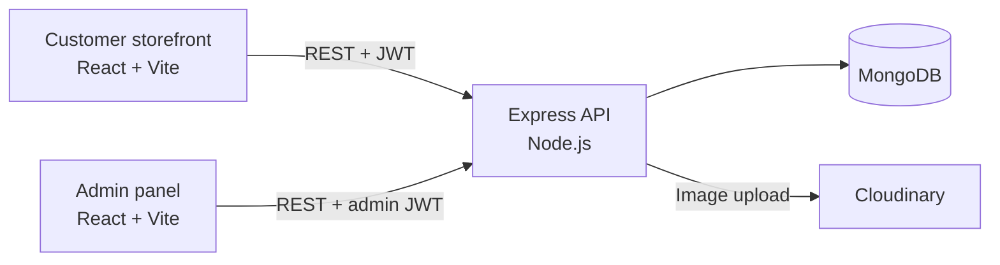

# Florazon

Florazon is a full-stack e-commerce platform for ordering fresh flowers online, built with the MERN stack (MongoDB, Express, React, Node.js). It has a customer storefront, a separate admin panel for store management, and a REST API that both clients use.


## Overview

Florazon lets customers browse a catalogue of bouquets, single flowers, garlands and baskets, manage a cart that is saved to their account, and place Cash on Delivery orders. Store administrators use a dedicated panel to publish products, with images hosted on Cloudinary, and to move orders through each stage of delivery.

The repository contains three independent applications:

| Application | Description | Default URL |
| --- | --- | --- |
| `frontend/` | Customer storefront | http://localhost:5173 |
| `admin/` | Store administration panel | http://localhost:5175 |
| `backend/` | REST API used by both clients | http://localhost:4000 |

## Features

### Customer Storefront

- **Authentication:** customers register, log in and log out using JWT-based sessions. Expired sessions sign out automatically.
- **Profile management:** customers can update their name and email, and change their password after confirming the current one.
- **Product catalogue:** the home page shows the latest arrivals and best sellers.
- **Search, filtering and sorting:** search by product name, filter by category (Occasion, Gift-Type) and type (Single-Flower, Bouquet, Garland, Basket), and sort by price.
- **Product details:** each product has an image gallery, size selection, a description and related products.
- **Persistent cart:** customers can add, update and remove items. Items added before logging in are merged into the account at sign-in.
- **Checkout:** a delivery details form with Cash on Delivery payment.
- **Order tracking:** order history shows the current status of each order, from Order Placed through Packing, Shipped and Out for delivery to Delivered.
- **Responsive layout:** the storefront is optimised for desktop, tablet and mobile.

### Admin Panel

- **Secure login:** admin credentials are kept in server environment variables, and admin tokens expire after a set time.
- **Product creation:** admins add products with up to four images uploaded to Cloudinary, plus category, type, sizes, price and a best-seller flag.
- **Catalogue management:** admins can view all products and remove them, with a confirmation step.
- **Order management:** admins can review every order with customer and address details, and update its delivery status.

## Screenshots

| Collection with filters | Product details |
| --- | --- |
|  |  |

| Shopping cart | Order history |
| --- | --- |
|  |  |

| Admin: product list | Admin: order management |
| --- | --- |
|  |  |

| Admin: add product | Mobile view |
| --- | --- |
|  |  |

## Technology Stack

| Layer | Technologies |
| --- | --- |
| Frontend and admin | React 19, React Router 7, Vite 7, Tailwind CSS 3, Axios, React Toastify |
| Backend | Node.js, Express 5, Mongoose 8 |
| Database | MongoDB (Atlas or self-hosted) |
| Authentication and security | JSON Web Tokens, bcrypt, validator |
| File uploads | Multer, Cloudinary |
| Tooling | ESLint 9, Nodemon, PostCSS, Autoprefixer |

## Architecture



- **Stateless authentication:** the API issues JWTs. Customer tokens are valid for 7 days and admin tokens for 1 day.
- **Server-side pricing:** order totals are calculated from database prices and never taken from the client.
- **Persistent carts:** carts are stored on the user record, so they survive page reloads and follow the customer across devices.

## Getting Started

### Prerequisites

- [Node.js](https://nodejs.org/) 20 or later, with npm
- A [MongoDB](https://www.mongodb.com/atlas) database (MongoDB Atlas or a local instance)
- A [Cloudinary](https://cloudinary.com/) account for product image storage

### 1. Clone the repository

```bash
git clone https://github.com/AzmariSultana/Florazon.git
cd Florazon
```

### 2. Install dependencies

```bash
cd backend && npm install && cd ..
cd frontend && npm install && cd ..
cd admin && npm install && cd ..
```

### 3. Configure environment variables

Each application includes a `.env.example` file. Copy it to `.env` in the same folder and provide your values.

**backend/.env**

| Variable | Description |
| --- | --- |
| `PORT` | Port for the API (default `4000`) |
| `MONGODB_URI` | MongoDB connection string. The `florazon` database is selected automatically. |
| `JWT_SECRET` | Long random string used to sign tokens |
| `ADMIN_EMAIL` | Email address for the admin panel login |
| `ADMIN_PASSWORD` | Password for the admin panel login |
| `CLOUDINARY_NAME` | Cloudinary cloud name |
| `CLOUDINARY_API_KEY` | Cloudinary API key |
| `CLOUDINARY_SECRET_KEY` | Cloudinary API secret |

**frontend/.env** and **admin/.env**

| Variable | Description |
| --- | --- |
| `VITE_BACKEND_URL` | Base URL of the API, for example `http://localhost:4000` |

`.env` files are excluded from version control. Do not commit real credentials.

### 4. Start the applications

Run each application in its own terminal.

```bash
cd backend
npm run server
```

```bash
cd frontend
npm run dev
```

```bash
cd admin
npm run dev
```

### 5. Load the product catalogue

With `backend/.env` configured, import the catalogue into MongoDB. Each photo is uploaded to Cloudinary.

```bash
cd backend
npm run seed
```

The script adds products that are not in the database yet and never deletes anything. Run `npm run seed -- --update` to refresh existing products with the catalogue data. Each run ends with a report of duplicate products, products that are not in the catalogue, and products without an image.

### Available Scripts

| Location | Command | Description |
| --- | --- | --- |
| `backend` | `npm start` | Start the API with Node.js |
| `backend` | `npm run server` | Start the API with Nodemon (reloads on changes) |
| `backend` | `npm run seed` | Import the product catalogue into MongoDB and Cloudinary |
| `frontend`, `admin` | `npm run dev` | Start the Vite development server |
| `frontend`, `admin` | `npm run build` | Create a production build in `dist/` |
| `frontend`, `admin` | `npm run preview` | Serve the production build locally |
| `frontend`, `admin` | `npm run lint` | Run ESLint |

## Usage

1. **Add products:** load the catalogue with `npm run seed`, or open the admin panel at http://localhost:5175, sign in with `ADMIN_EMAIL` and `ADMIN_PASSWORD`, and use **Add Items** to upload images and product details.
2. **Browse and shop:** open the storefront at http://localhost:5173, browse or search the collection, select a size and add items to the cart.
3. **Check out:** create an account or log in, go to checkout, enter delivery details and place a Cash on Delivery order.
4. **Fulfil orders:** in the admin panel, open **Orders** and update the order status. The customer sees the change under **My Orders**.

## Deployment

The API is deployed to [Render](https://render.com) and the two React applications to [Vercel](https://vercel.com). Deploy the API first, because both frontends need its URL.

### 1. API on Render

The repository includes a Render Blueprint (`render.yaml`) that configures the service.

1. In MongoDB Atlas, open **Network Access** and allow connections from `0.0.0.0/0`. Render's free plan does not use fixed IP addresses.
2. In Render, choose **New > Blueprint** and select this repository.
3. Enter the requested environment variables: `MONGODB_URI`, `ADMIN_EMAIL`, `ADMIN_PASSWORD`, `CLOUDINARY_NAME`, `CLOUDINARY_API_KEY` and `CLOUDINARY_SECRET_KEY`. `JWT_SECRET` is generated automatically. Leave `CORS_ORIGINS` empty for now.
4. Deploy. When the service is live, opening its URL (for example `https://florazon-api.onrender.com`) shows `API Working`.

On the free plan the service sleeps after a period of inactivity, so the first request afterwards can take up to a minute.

### 2. Storefront and admin panel on Vercel

Create two Vercel projects from this repository, one for each application. Each folder contains a `vercel.json` with the build settings and the routing rule that keeps page links working on refresh.

| Setting | Storefront project | Admin project |
| --- | --- | --- |
| Root Directory | `frontend` | `admin` |
| Framework Preset | Vite (detected) | Vite (detected) |
| Environment variable | `VITE_BACKEND_URL` = Render API URL | `VITE_BACKEND_URL` = Render API URL |

Enter the API URL without a trailing slash. Vite includes environment variables at build time, so redeploy a project after changing its `VITE_BACKEND_URL`.

### 3. Connect the API to the frontends

Return to the Render service and set `CORS_ORIGINS` to both Vercel URLs, separated by a comma:

```
https://florazon.vercel.app,https://florazon-admin.vercel.app
```

Save the change to redeploy the API. From then on, the API only accepts browser requests from these two sites.

### Alternative: GitHub Pages

`.github/workflows/deploy-pages.yml` can also publish both applications to GitHub Pages, at https://azmarisultana.github.io/Florazon/ and https://azmarisultana.github.io/Florazon/admin/. It runs on pushes to `main` that change `frontend/` or `admin/` and reads the API URL from the repository variable `VITE_BACKEND_URL` (**Settings > Secrets and variables > Actions > Variables**). If you use it, add the Pages URL to `CORS_ORIGINS` as well.

## Security

- **Passwords** are hashed with bcrypt, and changing a password requires the current one.
- **JWT sessions** expire. Admin tokens carry a role claim and never contain credentials.
- **Order totals** are calculated on the server, and item sizes and quantities are validated.
- **MongoDB query filters** are sanitised to prevent operator injection.
- **Cart input** is validated to prevent prototype pollution.
- **Uploads** are limited to image files under 5 MB, and temporary files are deleted after upload.

## Project Structure

```
Florazon/
├── backend/                 Express REST API
│   ├── config/              MongoDB and Cloudinary configuration
│   ├── controllers/         Request handlers (user, product, cart, order)
│   ├── middleware/          Customer and admin authentication, file uploads
│   ├── models/              Mongoose schemas
│   ├── routes/              Route definitions
│   ├── seed/                Product catalogue data, optimised photos and import script
│   └── server.js            Application entry point
├── frontend/                Customer storefront (React + Vite)
│   └── src/
│       ├── components/      Shared UI components
│       ├── context/         Global state: products, cart, authentication
│       └── pages/           Application pages
├── admin/                   Admin panel (React + Vite)
│   └── src/
│       ├── components/      Login, navigation bar, sidebar
│       └── pages/           Add, list and order management pages
└── docs/screenshots/        Images used in this README
```

## Roadmap

- Online payment integration (for example SSLCommerz or Stripe) alongside Cash on Delivery
- Editing existing products from the admin panel
- Password reset by email
- Sales dashboard with order and revenue statistics
- Product reviews and ratings
- Automated tests and continuous integration


## Author

**Azmari Sultana**

- GitHub: [AzmariSultana](https://github.com/AzmariSultana)
- Email: azmari.sultana47@gmail.com
