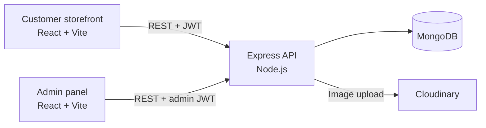

# Florazon

Florazon is a full-stack e-commerce platform for ordering fresh flowers online, built with the MERN stack (MongoDB, Express, React, Node.js). It has a customer storefront, a separate admin panel for store management, and a REST API that both clients use.


## Overview

Florazon lets customers browse a catalogue of bouquets, single flowers, garlands and baskets, manage a cart that is saved to their account, and place Cash on Delivery orders. Store administrators use a dedicated panel to publish products, with images hosted on Cloudinary, and to move orders through each stage of delivery.

The repository contains three independent applications:

| Application | Description | Default URL |
| --- | --- | --- |
| `frontend/` | Customer storefront | http://localhost:5173 |
| `admin/` | Store administration panel | http://localhost:5175 |
| `backend/` | REST API used by both clients | http://localhost:4000 |

## Features

### Customer Storefront

- **Authentication:** customers register, log in and log out using JWT-based sessions. Expired sessions sign out automatically.
- **Profile management:** customers can update their name and email, and change their password after confirming the current one.
- **Product catalogue:** the home page shows the latest arrivals and best sellers.
- **Search, filtering and sorting:** search by product name, filter by category (Occasion, Gift-Type) and type (Single-Flower, Bouquet, Garland, Basket), and sort by price.
- **Product details:** each product has an image gallery, size selection, a description and related products.
- **Persistent cart:** customers can add, update and remove items. Items added before logging in are merged into the account at sign-in.
- **Checkout:** a delivery details form with Cash on Delivery payment.
- **Order tracking:** order history shows the current status of each order, from Order Placed through Packing, Shipped and Out for delivery to Delivered.
- **Responsive layout:** the storefront is optimised for desktop, tablet and mobile.

### Admin Panel

- **Secure login:** admin credentials are kept in server environment variables, and admin tokens expire after a set time.
- **Product creation:** admins add products with up to four images uploaded to Cloudinary, plus category, type, sizes, price and a best-seller flag.
- **Catalogue management:** admins can view all products and remove them, with a confirmation step.
- **Order management:** admins can review every order with customer and address details, and update its delivery status.

## Screenshots

| Collection with filters | Product details |
| --- | --- |
|  |  |

| Shopping cart | Order history |
| --- | --- |
|  |  |

| Admin: product list | Admin: order management |
| --- | --- |
|  |  |

| Admin: add product | Mobile view |
| --- | --- |
|  |  |

## Product Catalogue

The store includes a catalogue of 34 bouquets photographed by the owner. Product data is stored in `backend/seed/products.json` and the web-optimised photos in `backend/seed/images/`. See [Load the product catalogue](#5-load-the-product-catalogue) to import them.

<details>
<summary>View all 34 products</summary>

| Product | Description | Category | Type | Sizes | Price (BDT) |
| --- | --- | --- | --- | --- | --- |
| Red Rose & Pink Carnation Bouquet | Deep red roses and soft pink carnations with sprigs of gypsophila, wrapped in rich crimson paper. A bold, romantic arrangement for anniversaries and Valentine's Day. | Occasion | Bouquet | M, L | 2,400 |
| Pink Chrysanthemum Bouquet | Dusky pink chrysanthemums with dark centres, filled out with clouds of gypsophila and wrapped in peach paper. A soft, cheerful gift for any day. | Gift-Type | Bouquet | S, M | 1,300 |
| Single Pink Lily | One pink stargazer lily framed with gypsophila and wrapped in white paper. A simple, elegant way to say thank you. | Gift-Type | Single-Flower | One size | 650 |
| Hot Pink Rose & Carnation Bouquet | Three hot pink roses with light pink spray carnations, purple statice and eucalyptus, wrapped in blush pink paper. | Occasion | Bouquet | M | 1,900 |
| Pink Gerbera Trio | Three salmon-pink gerberas with gypsophila, wrapped in pink paper and newsprint and finished with a pink ribbon. | Gift-Type | Bouquet | S | 900 |
| Pink Rose Trio | Three pink roses surrounded by gypsophila in lilac-pink wrapping, tied with natural twine. | Gift-Type | Bouquet | S | 1,000 |
| Pink Gerbera & Lily Bouquet | Two pink gerberas, pink lilies in bloom and bud, and a blush garden rose with gypsophila, presented in frosted white wrapping. | Gift-Type | Bouquet | S, M | 1,600 |
| Mint Meadow Mixed Bouquet | A vibrant mix of orange gerberas, pink and purple daisy chrysanthemums, green and yellow button chrysanthemums, white and red roses, solidago and eucalyptus in mint green wrapping. | Occasion | Bouquet | L | 3,400 |
| Pink Lily & Gerbera Bouquet | Pink lilies and a white lily with pink gerberas and pink and white chrysanthemums, arranged in peach wrapping. | Occasion | Bouquet | M, L | 2,800 |
| Single Sunflower | One bright sunflower nestled in gypsophila, wrapped in brown kraft paper with a printed satin ribbon. | Gift-Type | Single-Flower | One size | 700 |
| Yellow Tulip Bouquet | A bunch of fresh yellow tulips in butter-yellow and white wrapping, tied with a white organza ribbon. | Gift-Type | Bouquet | M | 2,000 |
| Lavender Gerbera & Rose Bouquet | Pink gerberas and lavender roses with purple button chrysanthemums, white and pink daisy chrysanthemums and deep purple carnations in layered lilac wrapping. | Occasion | Bouquet | L | 3,000 |
| Yellow Rose Bouquet | Fifteen yellow roses with gypsophila and fresh greenery, wrapped in cream paper and tied with a yellow satin ribbon. | Occasion | Bouquet | M, L | 3,300 |
| Pink Tulip Bouquet | Pink tulips with a few white tulips and gypsophila in soft pink wrapping, finished with a pink satin ribbon. | Gift-Type | Bouquet | M | 2,400 |
| Blue Rose Bouquet | Three blue-dyed roses surrounded by gypsophila and wrapped in pale blue paper. A striking, unusual gift. | Gift-Type | Bouquet | S | 1,500 |
| Sunflower Sunshine Bouquet | Five sunflowers with white roses, gypsophila, solidago and eucalyptus in cream wrapping, finished with a gold ribbon, charms and a "You are my sunshine" card. | Gift-Type | Bouquet | L | 3,600 |
| Red & Pink Rose Bouquet | Red and pink roses with generous gypsophila in peach wrapping, a classic mix for birthdays and anniversaries. | Occasion | Bouquet | M | 2,000 |
| Sunflower & Lily Mixed Bouquet | Sunflowers, white and pink lilies, pink and yellow carnations and purple chrysanthemums with gypsophila, in white polka-dot wrapping. | Occasion | Bouquet | M, L | 2,500 |
| Pink & White Rose Bouquet | Pink and white roses with gypsophila in soft pink tissue wrapping. | Occasion | Bouquet | M | 2,100 |
| White Lily Bouquet | White oriental lilies in full bloom and bud, wrapped in kraft paper and newsprint and tied with a polka-dot ribbon. | Gift-Type | Bouquet | M | 2,300 |
| Grand Mixed Celebration Bouquet | A full, round bouquet of red and pink roses, pink lisianthus, yellow and magenta chrysanthemums, hypericum berries and gypsophila in white wrapping. | Occasion | Bouquet | L | 3,800 |
| Pink Rose Bouquet | Two-tone pink roses with gypsophila, wrapped in white paper. | Gift-Type | Bouquet | M | 1,900 |
| Sunflower & Gerbera Grand Bouquet | A large, joyful bouquet of sunflowers, white, peach and pink gerberas, hot pink roses and daisies with gypsophila in pink wrapping. | Occasion | Bouquet | L | 4,200 |
| Lavender Dreams Bouquet | Purple and lilac roses with white roses, lilac stock, lisianthus buds and gypsophila, wrapped in kraft paper and tied with a lavender ribbon. | Occasion | Bouquet | M, L | 3,200 |
| Red & White Rose Bouquet | Classic red and white roses generously filled with gypsophila and wrapped in natural kraft paper. | Occasion | Bouquet | S, M, L | 2,500 |
| Sunshine Gerbera Bouquet | Yellow, pink, lilac and cream gerberas with orange spray roses, daisies and solidago in kraft wrapping, finished with a pink ribbon. | Gift-Type | Bouquet | S, M | 1,800 |
| Lily & Red Rose Bouquet | White oriental lilies and red roses with gypsophila in white wrapping, tied with a champagne satin ribbon. | Occasion | Bouquet | M, L | 2,800 |
| White Rose & Blue Gypsophila | White roses paired with blue-tinted gypsophila in soft white tissue wrapping. | Gift-Type | Bouquet | M, L | 2,200 |
| Pink Lily Romance | Pink stargazer lilies and pink roses with gypsophila in blush wrapping with a pink satin bow. | Occasion | Bouquet | M, L | 2,900 |
| Pastel Garden Bouquet | Peach roses, white gerberas, pink lisianthus, a pink lily, statice and eucalyptus in white wrapping with a champagne ribbon. | Gift-Type | Bouquet | M, L | 2,600 |
| Gerbera Celebration Bouquet | Red, pink and yellow gerberas with white daisy chrysanthemums, a peach rose and gypsophila in pink wrapping. | Occasion | Bouquet | S, M | 1,900 |
| Classic Red Rose Bouquet | Eleven velvet red roses with gypsophila and eucalyptus in kraft and sheer wrapping, tied with a burgundy ribbon and a "for you" card. | Occasion | Bouquet | M, L | 3,500 |
| Blush Pastel Bouquet | Pink and white gerberas, pink chrysanthemums, peach and lilac roses, white daisies and purple statice in blush pink wrapping. | Gift-Type | Bouquet | M, L | 2,700 |
| White Lily & Pink Rose Bouquet | White lilies with pink and white spray roses and gypsophila in blush pink wrapping, finished with a cream satin ribbon. | Gift-Type | Bouquet | M, L | 2,700 |

</details>

## Technology Stack

| Layer | Technologies |
| --- | --- |
| Frontend and admin | React 19, React Router 7, Vite 7, Tailwind CSS 3, Axios, React Toastify |
| Backend | Node.js, Express 5, Mongoose 8 |
| Database | MongoDB (Atlas or self-hosted) |
| Authentication and security | JSON Web Tokens, bcrypt, validator |
| File uploads | Multer, Cloudinary |
| Tooling | ESLint 9, Nodemon, PostCSS, Autoprefixer |

## Architecture



- **Stateless authentication:** the API issues JWTs. Customer tokens are valid for 7 days and admin tokens for 1 day.
- **Server-side pricing:** order totals are calculated from database prices and never taken from the client.
- **Persistent carts:** carts are stored on the user record, so they survive page reloads and follow the customer across devices.

## Getting Started

### Prerequisites

- [Node.js](https://nodejs.org/) 20 or later, with npm
- A [MongoDB](https://www.mongodb.com/atlas) database (MongoDB Atlas or a local instance)
- A [Cloudinary](https://cloudinary.com/) account for product image storage

### 1. Clone the repository

```bash
git clone https://github.com/AzmariSultana/Florazon.git
cd Florazon
```

### 2. Install dependencies

```bash
cd backend && npm install && cd ..
cd frontend && npm install && cd ..
cd admin && npm install && cd ..
```

### 3. Configure environment variables

Each application includes a `.env.example` file. Copy it to `.env` in the same folder and provide your values.

**backend/.env**

| Variable | Description |
| --- | --- |
| `PORT` | Port for the API (default `4000`) |
| `MONGODB_URI` | MongoDB connection string. The `florazon` database is selected automatically. |
| `JWT_SECRET` | Long random string used to sign tokens |
| `ADMIN_EMAIL` | Email address for the admin panel login |
| `ADMIN_PASSWORD` | Password for the admin panel login |
| `CLOUDINARY_NAME` | Cloudinary cloud name |
| `CLOUDINARY_API_KEY` | Cloudinary API key |
| `CLOUDINARY_SECRET_KEY` | Cloudinary API secret |

**frontend/.env** and **admin/.env**

| Variable | Description |
| --- | --- |
| `VITE_BACKEND_URL` | Base URL of the API, for example `http://localhost:4000` |

`.env` files are excluded from version control. Do not commit real credentials.

### 4. Start the applications

Run each application in its own terminal.

```bash
cd backend
npm run server
```

```bash
cd frontend
npm run dev
```

```bash
cd admin
npm run dev
```

### 5. Load the product catalogue

With `backend/.env` configured, import the catalogue into MongoDB. Each photo is uploaded to Cloudinary.

```bash
cd backend
npm run seed
```

The script adds products that are not in the database yet and never deletes anything. Run `npm run seed -- --update` to refresh existing products with the catalogue data. Each run ends with a report of duplicate products, products that are not in the catalogue, and products without an image.

### Available Scripts

| Location | Command | Description |
| --- | --- | --- |
| `backend` | `npm start` | Start the API with Node.js |
| `backend` | `npm run server` | Start the API with Nodemon (reloads on changes) |
| `backend` | `npm run seed` | Import the product catalogue into MongoDB and Cloudinary |
| `frontend`, `admin` | `npm run dev` | Start the Vite development server |
| `frontend`, `admin` | `npm run build` | Create a production build in `dist/` |
| `frontend`, `admin` | `npm run preview` | Serve the production build locally |
| `frontend`, `admin` | `npm run lint` | Run ESLint |

## Usage

1. **Add products:** load the catalogue with `npm run seed`, or open the admin panel at http://localhost:5175, sign in with `ADMIN_EMAIL` and `ADMIN_PASSWORD`, and use **Add Items** to upload images and product details.
2. **Browse and shop:** open the storefront at http://localhost:5173, browse or search the collection, select a size and add items to the cart.
3. **Check out:** create an account or log in, go to checkout, enter delivery details and place a Cash on Delivery order.
4. **Fulfil orders:** in the admin panel, open **Orders** and update the order status. The customer sees the change under **My Orders**.

## Deployment

### Storefront and admin panel (GitHub Pages)

The workflow in `.github/workflows/deploy-pages.yml` builds both React applications and publishes them to GitHub Pages. It runs on every push to `main` that changes `frontend/` or `admin/`, and it can also be started manually from the **Actions** tab.

| Application | URL |
| --- | --- |
| Storefront | https://azmarisultana.github.io/Florazon/ |
| Admin panel | https://azmarisultana.github.io/Florazon/admin/ |

One-time setup:

1. In **Settings > Pages**, set **Source** to **GitHub Actions**.
2. In **Settings > Secrets and variables > Actions > Variables**, add a repository variable named `VITE_BACKEND_URL` set to the URL of the deployed API.
3. Re-run the workflow so the new variable is included in the build.

### API (Node.js hosting)

GitHub Pages only serves static files, so the Express API must be hosted separately. You can use any Node.js host, such as Render, Railway or Fly.io. Configure it as follows:

- **Root directory:** `backend`
- **Build command:** `npm install`
- **Start command:** `npm start`
- **Environment variables:** the variables listed under [Configure environment variables](#3-configure-environment-variables)

In MongoDB Atlas, allow connections from the host under **Network Access**. Once the API is running, set its URL as `VITE_BACKEND_URL` as described above.


## Security

- **Passwords** are hashed with bcrypt, and changing a password requires the current one.
- **JWT sessions** expire. Admin tokens carry a role claim and never contain credentials.
- **Order totals** are calculated on the server, and item sizes and quantities are validated.
- **MongoDB query filters** are sanitised to prevent operator injection.
- **Cart input** is validated to prevent prototype pollution.
- **Uploads** are limited to image files under 5 MB, and temporary files are deleted after upload.

## Project Structure

```
Florazon/
├── backend/                 Express REST API
│   ├── config/              MongoDB and Cloudinary configuration
│   ├── controllers/         Request handlers (user, product, cart, order)
│   ├── middleware/          Customer and admin authentication, file uploads
│   ├── models/              Mongoose schemas
│   ├── routes/              Route definitions
│   ├── seed/                Product catalogue data, optimised photos and import script
│   └── server.js            Application entry point
├── frontend/                Customer storefront (React + Vite)
│   └── src/
│       ├── components/      Shared UI components
│       ├── context/         Global state: products, cart, authentication
│       └── pages/           Application pages
├── admin/                   Admin panel (React + Vite)
│   └── src/
│       ├── components/      Login, navigation bar, sidebar
│       └── pages/           Add, list and order management pages
└── docs/screenshots/        Images used in this README
```

## Roadmap

- Online payment integration (for example SSLCommerz or Stripe) alongside Cash on Delivery
- Editing existing products from the admin panel
- Password reset by email
- Sales dashboard with order and revenue statistics
- Product reviews and ratings
- Automated tests and continuous integration


## Author

**Azmari Sultana**

- GitHub: [AzmariSultana](https://github.com/AzmariSultana)
- Email: azmari.sultana47@gmail.com
