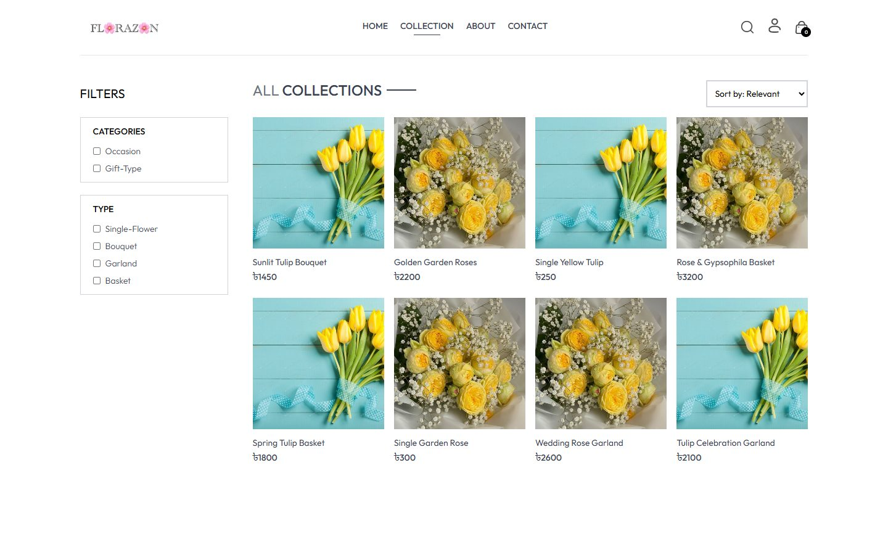
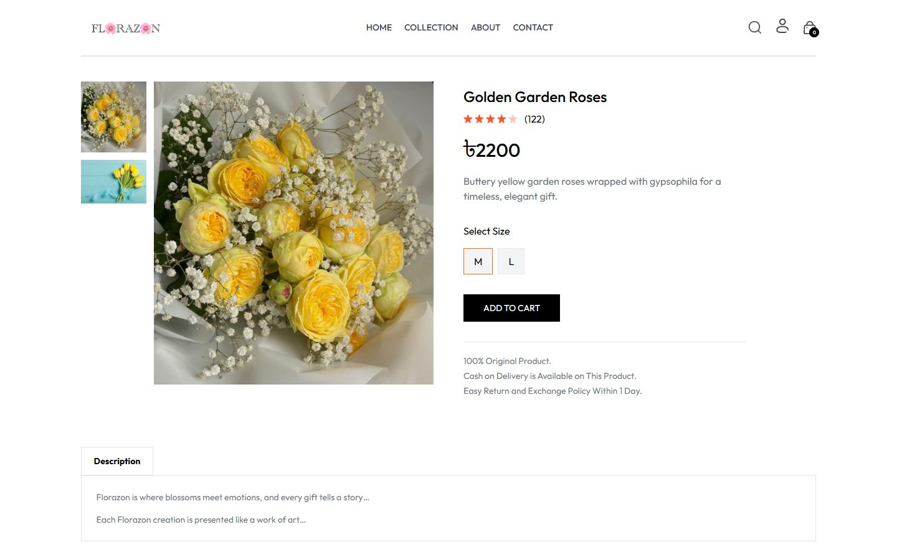
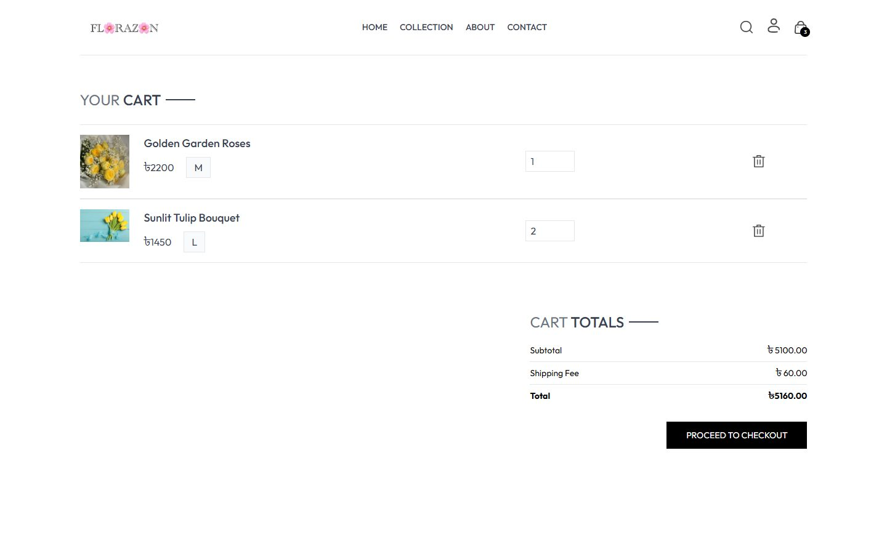
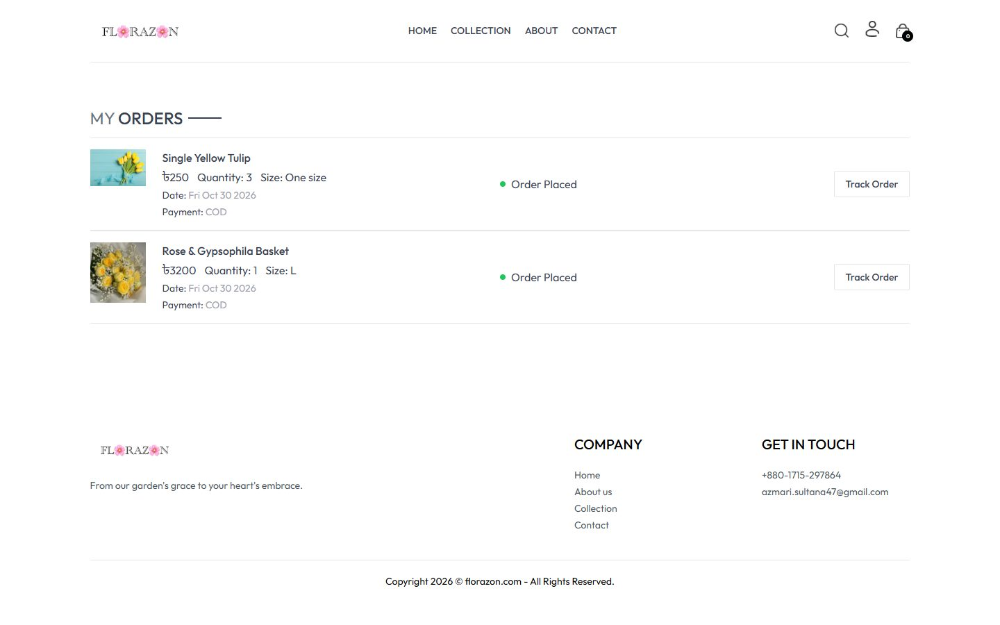
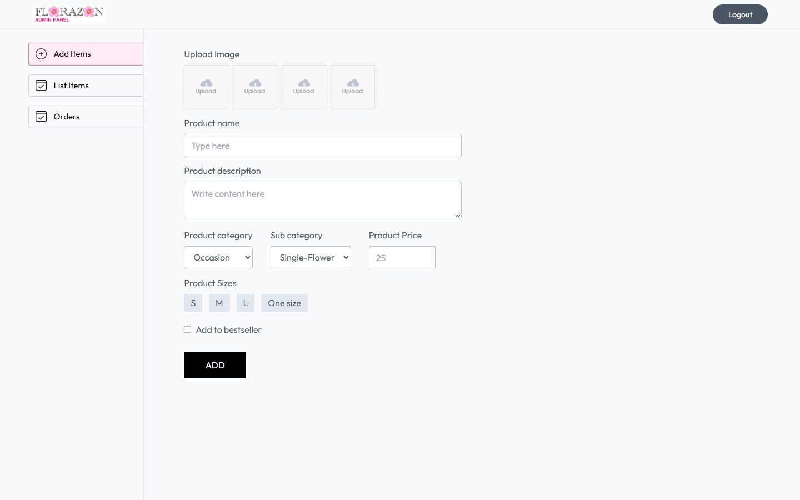
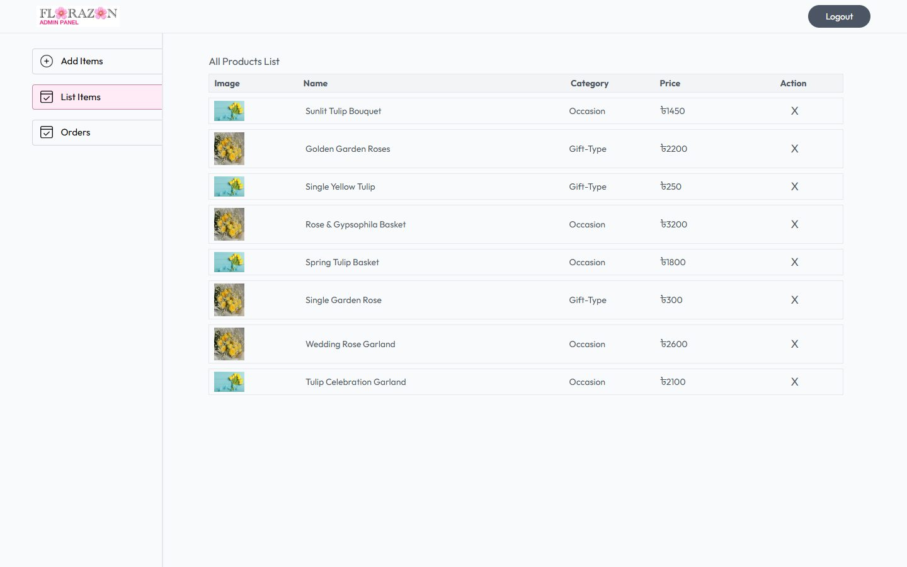

<div align="center">

# 🌸 Florazon

**A full-stack MERN e-commerce platform for ordering fresh flowers online.**

*From our garden's grace to your heart's embrace.*


</div>

---

## 📖 Table of Contents

- [About the Project](#-about-the-project)
- [Key Features](#-key-features)
- [Screenshots](#-screenshots)
- [Tech Stack](#-tech-stack)
- [Architecture](#-architecture)
- [Getting Started](#-getting-started)
- [Usage](#-usage)
- [API Reference](#-api-reference)
- [Security](#-security)
- [Project Structure](#-project-structure)
- [Roadmap](#-roadmap)
- [Author](#-author)

---

## 🌷 About the Project

**Florazon** is an online flower shop built with the **MERN stack**. Customers can browse bouquets, single stems, garlands and baskets, filter and search the catalogue, manage a cart that syncs across devices, and place **Cash on Delivery** orders. Store owners use a separate **admin panel** to publish products (with images hosted on Cloudinary) and move orders through their delivery lifecycle.

The project is split into three independent apps:

| App | Purpose | Default URL |
| --- | --- | --- |
| **`frontend/`** | Customer-facing storefront | http://localhost:5173 |
| **`admin/`** | Store management panel | http://localhost:5175 |
| **`backend/`** | REST API shared by both clients | http://localhost:4000 |

---

## ✨ Key Features

### 🛍️ Customer storefront
- **Account system**: sign up, log in and log out with JWT-based sessions. Expired sessions sign out automatically.
- **Profile management**: update your name and email, and change your password (requires the current password).
- **Product catalogue**: latest arrivals and best sellers on the home page.
- **Search, filter & sort**: live search by name, filter by category (*Occasion*, *Gift-Type*) and type (*Single-Flower*, *Bouquet*, *Garland*, *Basket*), and sort by price.
- **Product details**: image gallery, size selection, description and related products.
- **Persistent cart**: add, update and remove items. Guests can shop before logging in, and their cart is merged into their account on sign-in.
- **Checkout**: delivery details form with **Cash on Delivery** payment.
- **Order history & tracking**: see every item ordered with live status (*Order Placed → Packing → Shipped → Out for delivery → Delivered*).
- **Responsive design**: mobile-first layout with a slide-out navigation menu.

### 🛠️ Admin panel
- **Secure admin login**: credentials kept in server environment variables, with time-limited tokens.
- **Add products**: up to 4 images per product (uploaded to **Cloudinary**), plus category, type, sizes, price and a best-seller flag.
- **Manage catalogue**: list all products and remove them (with confirmation).
- **Manage orders**: view every order with customer and address details, and update its delivery status.

---

## 📸 Screenshots

> Screenshots use sample catalogue data.

| Collection with filters | Product details |
| --- | --- |
|  |  |

| Shopping cart | Order tracking |
| --- | --- |
|  |  |

| Admin: add product | Admin: manage orders |
| --- | --- |
|  |  |

<details>
<summary><b>More screenshots</b></summary>

<br>

**Admin: product list**



**Mobile home page**


</details>

---

## 🧰 Tech Stack

| Layer | Technologies |
| --- | --- |
| **Frontend & Admin** | React 19, React Router 7, Vite 7, Tailwind CSS 3, Axios, React Toastify |
| **Backend** | Node.js, Express 5, Mongoose 8 |
| **Database** | MongoDB (Atlas or local) |
| **Auth & Security** | JSON Web Tokens, bcrypt password hashing, validator |
| **File Uploads** | Multer + Cloudinary |
| **Tooling** | ESLint 9, Nodemon, PostCSS / Autoprefixer |

---

## 🏗️ Architecture


- **Stateless auth**: the API issues JWTs. Customer tokens expire after 7 days and admin tokens after 1 day.
- **Server-side pricing**: order totals are recalculated from the database, never trusted from the client.
- **Cart persistence**: carts are stored on the user document so they survive refreshes and follow the user across devices.

---

## 🚀 Getting Started

### Prerequisites

- [Node.js](https://nodejs.org/) **20+** and npm
- A [MongoDB](https://www.mongodb.com/atlas) database (Atlas free tier or local instance)
- A [Cloudinary](https://cloudinary.com/) account (free tier is enough) for product images

### 1. Clone the repository

```bash
git clone https://github.com/AzmariSultana/Florazon.git
cd Florazon
```

### 2. Install dependencies

```bash
cd backend && npm install && cd ..
cd frontend && npm install && cd ..
cd admin && npm install && cd ..
```

### 3. Configure environment variables

Each app includes a `.env.example`. Copy it to `.env` and fill in your values.

**`backend/.env`**

| Variable | Description |
| --- | --- |
| `PORT` | API port (default `4000`) |
| `MONGODB_URI` | MongoDB connection string. The `florazon` database is selected automatically. |
| `JWT_SECRET` | Long random string used to sign tokens |
| `ADMIN_EMAIL` | Admin panel login email |
| `ADMIN_PASSWORD` | Admin panel login password |
| `CLOUDINARY_NAME` | Cloudinary cloud name |
| `CLOUDINARY_API_KEY` | Cloudinary API key |
| `CLOUDINARY_SECRET_KEY` | Cloudinary API secret |

**`frontend/.env`** and **`admin/.env`**

| Variable | Description |
| --- | --- |
| `VITE_BACKEND_URL` | URL of the API, e.g. `http://localhost:4000` |

> 🔒 `.env` files are git-ignored. Never commit real credentials.

### 4. Run the apps

Open three terminals:

```bash
# Terminal 1: API (auto-reloads on changes)
cd backend
npm run server
```

```bash
# Terminal 2: customer storefront
cd frontend
npm run dev
```

```bash
# Terminal 3: admin panel
cd admin
npm run dev
```

### Available scripts

| Location | Command | Description |
| --- | --- | --- |
| `backend` | `npm start` | Start the API with Node |
| `backend` | `npm run server` | Start the API with Nodemon (auto-reload) |
| `frontend` / `admin` | `npm run dev` | Start the Vite dev server |
| `frontend` / `admin` | `npm run build` | Create a production build in `dist/` |
| `frontend` / `admin` | `npm run preview` | Preview the production build |
| `frontend` / `admin` | `npm run lint` | Run ESLint |

---

## 🧭 Usage

1. **Add products as an admin.** Open http://localhost:5175, sign in with `ADMIN_EMAIL` / `ADMIN_PASSWORD`, then use **Add Items** to upload images and product details.
2. **Shop as a customer.** Open http://localhost:5173, browse or search the **Collection**, choose a size and **Add to Cart**.
3. **Check out.** Create an account or log in, proceed to checkout, enter delivery details and place a **Cash on Delivery** order.
4. **Fulfil the order.** Back in the admin panel, open **Orders** and update the status. The customer sees it under **My Orders**.

---

## 🔌 API Reference

All endpoints are prefixed with `/api`. Customer routes expect a `token` header (or `Authorization: Bearer <token>`). Admin routes expect the admin `token` header.

| Method | Endpoint | Access | Description |
| --- | --- | --- | --- |
| `POST` | `/user/register` | Public | Create a customer account |
| `POST` | `/user/login` | Public | Log in as a customer |
| `POST` | `/user/admin` | Public | Log in as admin |
| `GET` | `/user/me` | Customer | Get profile |
| `PATCH` | `/user/me` | Customer | Update name / email |
| `PATCH` | `/user/me/password` | Customer | Change password |
| `GET` | `/product/list` | Public | List all products |
| `POST` | `/product/single` | Public | Get one product |
| `POST` | `/product/add` | Admin | Add a product (multipart, `image1`–`image4`) |
| `POST` | `/product/remove` | Admin | Remove a product |
| `POST` | `/cart/get` | Customer | Get cart |
| `POST` | `/cart/add` | Customer | Add an item to the cart |
| `POST` | `/cart/update` | Customer | Set an item's quantity |
| `POST` | `/order/place` | Customer | Place a COD order |
| `POST` | `/order/userorders` | Customer | List your orders |
| `POST` | `/order/list` | Admin | List all orders |
| `POST` | `/order/status` | Admin | Update order status |

---

## 🔐 Security

- Passwords hashed with **bcrypt**. Changing a password requires the current one.
- **JWT** sessions with expiry. Admin tokens carry a role claim and never contain credentials.
- **Server-side order pricing** prevents price tampering. Item sizes and quantities are validated.
- MongoDB **query sanitisation** blocks operator injection.
- Cart input is validated, which prevents prototype-pollution attacks.
- Uploads are limited to **images under 5 MB**, and temporary files are cleaned up after upload.

---

## 📁 Project Structure

```
Florazon/
├── backend/                 # Express REST API
│   ├── config/              # MongoDB & Cloudinary setup
│   ├── controllers/         # Route handlers (user, product, cart, order)
│   ├── middleware/          # Customer/admin auth, Multer uploads
│   ├── models/              # Mongoose schemas
│   ├── routes/              # API route definitions
│   └── server.js            # App entry point
├── frontend/                # Customer storefront (React + Vite)
│   └── src/
│       ├── components/      # Navbar, product cards, search bar, …
│       ├── context/         # ShopContext: cart, auth & products state
│       └── pages/           # Home, Collection, Product, Cart, Checkout, Orders, Profile, …
├── admin/                   # Admin panel (React + Vite)
│   └── src/
│       ├── components/      # Login, Navbar, Sidebar
│       └── pages/           # Add, List, Orders
└── docs/screenshots/        # README images
```

---

## 🗺️ Roadmap

- [ ] Online payments (e.g. SSLCommerz / Stripe) alongside Cash on Delivery
- [ ] Edit existing products from the admin panel
- [ ] Password reset via email
- [ ] Admin dashboard with sales statistics
- [ ] Product reviews and ratings
- [ ] Automated tests and CI

---

## 👩‍💻 Author

**Azmari Sultana**

- GitHub: [@AzmariSultana](https://github.com/AzmariSultana)
- Email: azmari.sultana47@gmail.com

If you like this project, consider giving it a ⭐ on GitHub!

<div align="center">

**FL🌸RAZ🌸N**: *From our garden's grace to your heart's embrace.*

</div>
